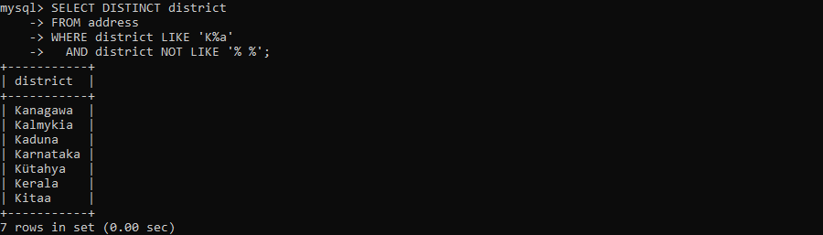
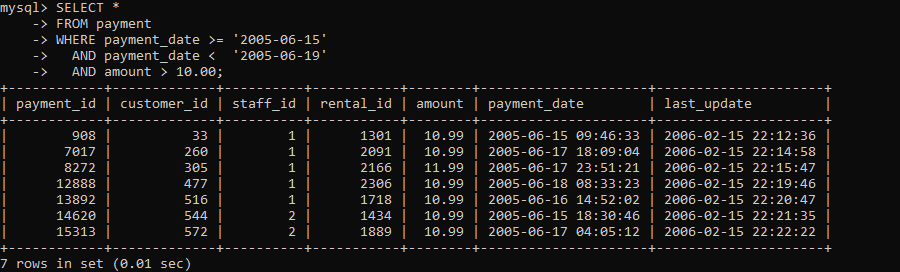
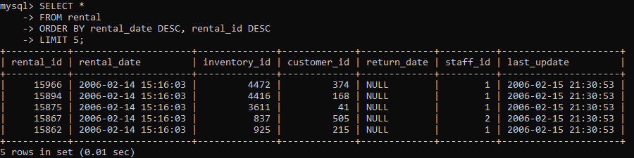
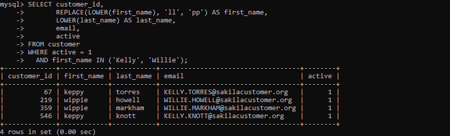

# Домашнее задание к занятию «SQL. Часть 1»


Все запросы выполнены в базе данных `sakila` (MySQL 8.4).

---

## Задание 1

Получите уникальные названия районов из таблицы с адресами, которые начинаются на «K» и заканчиваются на «a» и не содержат пробелов.

```sql
SELECT DISTINCT district
FROM address
WHERE district LIKE 'K%a'
  AND district NOT LIKE '% %';
```



---

## Задание 2

Получите из таблицы платежей за прокат фильмов информацию по платежам, которые выполнялись в промежуток с 15 июня 2005 года по 18 июня 2005 года включительно и стоимость которых превышает 10.00.

```sql
SELECT *
FROM payment
WHERE payment_date >= '2005-06-15'
  AND payment_date <  '2005-06-19'
  AND amount > 10.00;
```

Поле `payment_date` имеет тип `DATETIME`, поэтому верхняя граница задана как `< '2005-06-19'`: так в выборку попадает весь день 18 июня, включая время после 00:00:00.



---

## Задание 3

Получите последние пять аренд фильмов.

```sql
SELECT *
FROM rental
ORDER BY rental_date DESC, rental_id DESC
LIMIT 5;
```

У последних аренд одинаковая дата `2006-02-14 15:16:03`, поэтому добавлена вторая сортировка по `rental_id`, чтобы результат был однозначным.



---

## Задание 4

Одним запросом получите активных покупателей, имена которых Kelly или Willie. Все буквы в фамилии и имени переведите в нижний регистр, замените буквы 'll' в именах на 'pp'.

```sql
SELECT customer_id,
       REPLACE(LOWER(first_name), 'll', 'pp') AS first_name,
       LOWER(last_name) AS last_name,
       email,
       active
FROM customer
WHERE active = 1
  AND first_name IN ('Kelly', 'Willie');
```

Сначала выполняется `LOWER`, затем `REPLACE`: имена хранятся в верхнем регистре (`KELLY`), и замена строчных `ll` сработает только после перевода в нижний регистр.


